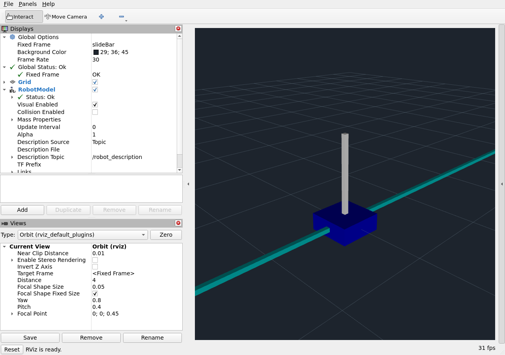
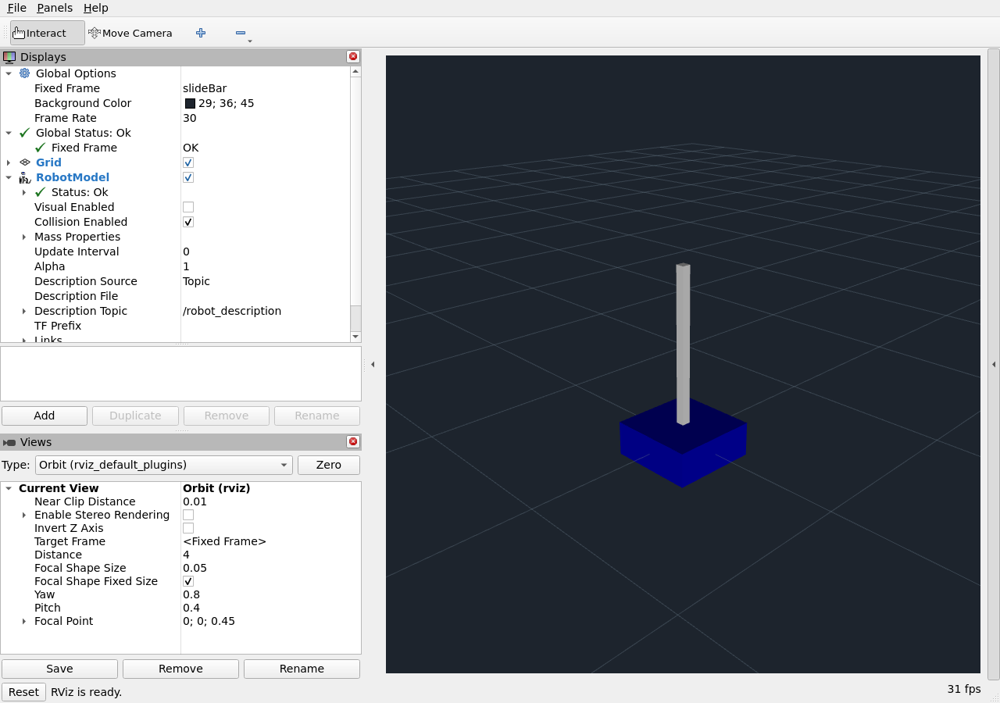

# urdf-doctor starter

Read-only Python CLI for link/joint names, graph roots/cycles, mass/inertia, finite vectors, joint limits/axes, collision omissions and mesh-path review. It never opens mesh paths, fetches URLs, expands untrusted xacro, edits input files or certifies hardware.

```sh
python urdf_doctor.py public-examples/cartpole.urdf --output data/cartpole-report.json
python -m pytest test_urdf_doctor.py -q
```

Three public Bullet descriptions are pinned by commit and SHA256 in `public-examples/PROVENANCE.json`, with the upstream Zlib licence retained. Original files remain unchanged. The reports distinguish errors from review warnings: a static base may intentionally have zero mass; a continuous joint can omit URDF limits but still needs controller effort/velocity review. The installed ROS Humble `check_urdf` parser independently accepted the original cartpole.

`demo_description/` packages the unchanged licensed cartpole for ROS 2 Humble installation. This is a syntax/packaging example, not a repaired or physically validated client robot. ROS 2 Humble package build, check_urdf parsing, live joint-state/TF delivery and two real RViz captures (visual and collision modes) pass. Both child transforms resolve from slideBar; Global Status and RobotModel Status show OK. Rendering used Xvfb and software OpenGL 4.5; it is bounded software evidence. Physical correctness, frame/unit/inertia review and hardware tests remain client-delivery review steps. No Isaac installation or local simulator claim.

`OFFERS.md` contains bounded FR/EN offers and monthly support. `ORDER.md` requires Reda's physical review and recorded diff/tests before every delivery. A public GitHub release is allowed only with these limitations intact; no client data is included.

Own CLI code: MIT. Upstream example data: Zlib; see its retained licence. No licence is asserted over third-party content beyond those terms.

## Verified RViz software rendering





The upstream static slide bar has no collision geometry; the collision capture correctly omits it. Its zero base mass and missing collision remain visible warnings in the lint report, not silently repaired physical assumptions. No mesh downloads, robot connection or controller commands are used.

To reproduce in the studio checkout after sourcing /opt/ros/humble/setup.bash: `/usr/bin/python3 scripts/validate_visual.py` and add `--collision` for the second view. In a standalone checkout, use `scripts/validate_visual.py`; output goes to ignored validation-output/. Xvfb, ImageMagick, ROS Humble robot_state_publisher, joint_state_publisher and RViz are required. ROS traffic is localhost-only on isolated domain 201; processes are cleaned up after capture.
